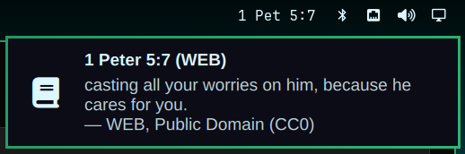

# Verse of the Day for Omarchy

An [Omarchy](https://omarchy.org) shell bar widget that shows today's Bible
verse reference (for example `Jas 1:22`). Click it and the full verse appears
as a single Omarchy notification, with the translation's credit. Clicking again
replaces that toast instead of stacking a new one.

- Plugin id: `io.github.georgeanderson.verse-of-the-day`
- Kind: `bar-widget` (Omarchy 4 "Quattro" shell)
- Default translation: World English Bible (public domain)



## Install

```bash
omarchy plugin add https://github.com/georgeanderson/omarchy-verse-of-the-day.git --enable
```

`omarchy plugin add` warns that plugins run unsandboxed, clones the repo into
`~/.config/omarchy/plugins/io.github.georgeanderson.verse-of-the-day/`, and
validates the manifest. It never runs an install script and never needs sudo.

Without `--enable`, turn it on later (it lands in the right section by default):

```bash
omarchy plugin enable io.github.georgeanderson.verse-of-the-day
# or place it yourself
omarchy bar put io.github.georgeanderson.verse-of-the-day --after omarchy.tray
```

Update with `omarchy plugin update io.github.georgeanderson.verse-of-the-day`.

## Remove

```bash
omarchy plugin remove io.github.georgeanderson.verse-of-the-day
# the plugin's cached verse is not removed by the command above:
rm -rf "${XDG_STATE_HOME:-$HOME/.local/state}/io.github.georgeanderson.verse-of-the-day"
```

`omarchy plugin remove` takes the widget off the bar and deletes the checkout.
The plugin writes nothing else: no config outside its own bar entry in
`~/.config/omarchy/shell.json`, no services, no autostart.

## Using it

| Action | Result |
| --- | --- |
| Left or right click | Shows the verse as a notification (low urgency, replaces the previous one) |
| Middle click | Re-checks the verse now |
| Hover | Full reference, translation credit, and a note if the verse is stale |

The label is dimmed while it is loading and when it shows a verse from an
earlier day (for example, offline since yesterday). It reads `Verse?` when
there is no network and no cached verse yet.

On a vertical bar (left or right) it shows a book icon only; hover or click for
the verse. Long labels are shortened with an ellipsis.

Optional keybinding, e.g. in `~/.config/hypr/bindings.conf`:

```
bind = SUPER ALT, V, exec, omarchy-shell io.github.georgeanderson.verse-of-the-day show
```

(`refresh` and `status` are also available on the same IPC target.)

## Settings

Settings live on the widget's entry in `~/.config/omarchy/shell.json` and can
be set with `omarchy bar set`:

```bash
omarchy bar set io.github.georgeanderson.verse-of-the-day translation kjv
omarchy bar set io.github.georgeanderson.verse-of-the-day labelStyle full
omarchy bar set io.github.georgeanderson.verse-of-the-day showCredit false --json
omarchy bar set io.github.georgeanderson.verse-of-the-day toastTimeoutSec 30 --json
```

| Key | Default | Values |
| --- | --- | --- |
| `translation` | `web` | `web` World English Bible, `kjv` King James, `asv` American Standard 1901, `bsb` Berean Standard, `ylt` Young's Literal, `dra` Douay-Rheims, `bbe` Bible in Basic English, `geneva1599` Geneva 1599, `lsv` Literal Standard Version, `darby` Darby, `rv1885` Revised Version |
| `labelStyle` | `short` | `short` (`Jas 1:22`), `full` (`James 1:22`), `glyph` (icon only) |
| `showCredit` | `true` | Show the translation credit under the verse in the toast. The tooltip always shows it, and translations whose license requires attribution (LSV, CC BY-SA 4.0) always show it. |
| `toastTimeoutSec` | `15` | 3 to 120 |

The list is the English set from `https://api.midvash.com/v1/versions?language=en`.
Unknown values fall back to `web`.

## When the verse changes

The verse source picks one verse per **UTC** day, so the verse changes at
00:00 UTC: 7 pm US Central daylight time (6 pm in winter), not at your local
midnight. The widget checks again about two minutes after 00:00 UTC.

## Network, privacy and caching

- **One HTTPS request per day** to `https://api.midvash.com/v1/votd`, made
  with `curl`. The API needs no key or account; midvash sees your IP address
  and the translation you chose. Nothing else is sent. See midvash's
  [terms](https://midvash.com/terms).
- Requests are conditional (`If-None-Match`), and nothing is requested while
  the cached verse is already today's. Failures are retried after 1, 5, 15 and
  30 minutes, then hourly.
- The last good verse is cached at
  `${XDG_STATE_HOME:-~/.local/state}/io.github.georgeanderson.verse-of-the-day/cache.json`
  so the bar still shows something offline and right after login. Delete that
  directory at any time; it is recreated on the next fetch.

## Dependencies

- Omarchy 4 shell (Quickshell bar) with `omarchy-notification-send`
- `curl` (installed on Omarchy by default)
- Network access to `api.midvash.com`

No GPU work, no extra processes besides one short `curl` and one
`omarchy-notification-send` per click.

## Verse text and licensing

Verse text comes from the free [midvash Bible API](https://api.midvash.com/).
The default World English Bible is in the public domain (CC0); KJV, ASV, BSB,
YLT, DRA, BBE, Geneva 1599, Darby and RV are public domain as well. The LSV is
licensed CC BY-SA 4.0 by Covenant Press, so its credit is always shown. The
plugin shows each translation's credit as the API provides it and does not
change the text.

## Development

```bash
scripts/check.sh   # omarchy plugin validate, node --test tests/, qmllint
```

`Logic.js` holds the pure logic (reference shortening, response parsing, cache
format); `tests/` loads it in Node. `BarWidget.qml` is the widget.

## License

[MIT](LICENSE) © 2026 George Guimaraes. Bible text is not covered by this
license; see each translation's credit.
